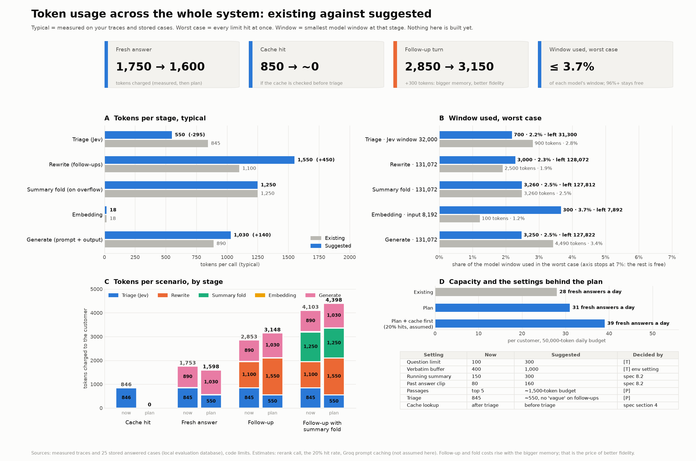

# Token and prompt plan (a proposal: nothing here is built)

Written 2026-10-21 for the owner. Every change below needs the owner's order. The numbers come from
the traces and the 25 stored answered evaluation cases ("measured"), from the code ("config"), or
are guesses ("estimate").

## 1. What the measurements say

- A fresh answered question is charged about **1,750 tokens** (triage 845, generate 890, embedding 18).
- The answer step uses **under 1%** of the 131,072-token window (prompt 746 on average, at most 1,337).
  Only about **2 passages** reach the generator (350 tokens), not 5.
- **The window is never the limit.** The limits are the per-minute and per-day tokens of the free plans
  (Groq 8,000 a minute, 200,000 a day for the judge), the customer's 50,000-token daily budget, and the
  tight settings below.
- Evaluation costs about 6 times what answering costs (12,000 to 27,000 judge tokens per case).

## 2. Changes proposed, with the reason

| # | Change | Where | Why | Decided by |
|---|---|---|---|---|
| 1 | Question limit 100 to 300 tokens (and the rewrite cap 200 to 300) | `app/guardrails/limits.py`, `app/pipeline/rewrite.py` | a two-part question with figures can pass 100 and is refused as too long; real use is 14 | [T] |
| 2 | Verbatim buffer 400 to 1,000 | `MEMORY_BUFFER_TOKENS` (a setting) | the buffer holds about 2 turns, so summaries start early and figures are lost | [T] |
| 3 | Running summary 150 to 300 | `app/memory/config.py` | 150 tokens is about 3 sentences for a whole conversation | spec 8.2 (decision) |
| 4 | Past answer clipped to 80 to 160 tokens | `app/memory/config.py` | the rewrite can see an answer cut before its key number | spec 8.2 (decision) |
| 5 | Answer prompt: ask for the whole answer (section 3) | `prompts/answer.v1.md` | `f05` answered "12.5 per cent" and dropped "above INR 1,25,000" | [P] |
| 6 | Rewrite prompt: stop asking for the product when the term names its topic (section 3) | `prompts/rewrite.v1.md` | `f01` and `t01` were sent back with "which product?" though answerable | [P] |
| 7 | Passages by a token budget (about 1,500) with a margin below the best score, instead of top 5 and a fixed 0.30 floor | `app/pipeline/retrieval.py`, `app/guardrails/context.py` | a second passage with the threshold is sometimes dropped; near-duplicates waste tokens | [P] |
| 8 | Triage: do not ask "vague first message" on follow-ups; shorten the wording | `app/pipeline/triage.py`, `app/gateway/questions.py` | its answer is unused on follow-ups; triage is the biggest recurring cost (845) | [P] |
| 9 | Check the cache before triage | pipeline order, spec section 4 | a hit still pays about 850 tokens and about 2 s; only verified answers are cached | spec 4 (decision) |
| 10 | Budget pre-check 3,400 to about 4,500 tokens | `app/pipeline/config.py` `estimated_request_tokens` | a follow-up costs 2,850 to 4,100, above the pre-check | [T] |
| 11 | Chunk overlap 60 to about 100 on the next ingest | `app/ingest/chunker.py` (owner-run re-ingest) | a rate and its threshold can fall on two sides of a boundary | [P] |
| 12 | Keep the answer prompt's fixed text first and the question last | already so | Groq caches such a prefix automatically for `gpt-oss`; cached tokens do not count toward its limits (Groq's docs; the minimum prefix is not verified) | none |

Already done and waiting for "commit": the judge on Groq with an OpenRouter fallback, RAGAS
`strictness` 1, the two RAGAS wrapper fixes (answer relevancy, answer correctness), the disclaimer
stripped before faithfulness is scored, `context_entity_recall` removed, 90% daily share, per-key
limits (`ONE_KEY_PER_PROVIDER` off), the first batch planned for what is left of today, and a batch
run in part when only part fits.

## 3. Prompt changes (the text I would write)

**Answer prompt**, under Constraints add:

> - Give the whole answer: include every condition, threshold, limit, exception, amount and period that
>   the documents attach to the fact, for example "on the gain above INR 1,25,000 in a financial year".
>   Use one to four plain sentences.

and replace the good example with:

> Question: What rate of long-term capital gains tax applies?
> {"answer": "Long-term capital gains are taxed at 12.5 per cent on the gain above INR 1,25,000 in a
> financial year (clause 5).", "citations": [{"chunk_id": "S1"}]}

Cost: about 60 to 100 tokens a call.

**Rewrite prompt**, replace the two lines about a "clear question" and "product or what is asked is missing" with:

> - A message is clear when it names what is asked (a charge, a rate, a period, a document, a claim
>   step, a limit) so that the documents could answer it. Terms that already name their topic, such as
>   penal charge, ABLR spread, waiting period or capital gains, are clear: rewrite them as they are and
>   do not ask which product.
> - Mark a message unclear only when it could not be searched at all (for example "what are the
>   charges?" with no earlier turn) or when it could mean different things with different answers.
>   Ask for one thing at a time.

**Triage wording** (to shorten, then measure against the golden cases): "Is the message a question about
banking, financial services or insurance?", "Does it depend on earlier messages (it, that, and for
seniors)?", "Is it too vague to search for?" (first message only).

## 4. Total context: minimum and maximum, with the edge cases

Tokens charged to the customer (model calls only; the rerank call is separate and about 2,500, at most
about 15,000).

| Situation | What runs | Minimum | Typical | Maximum (now) | Maximum (plan) |
|---|---|---|---|---|---|
| Empty, under 10 characters, or over the question limit | local checks | 0 | 0 | 0 | 0 |
| Greeting | fixed reply | 0 | 0 | 0 | 0 |
| Injection blocked by the local rules | local | 0 | 0 | 0 | 0 |
| Rate limit or daily budget refusal | before any model | 0 | 0 | 0 | 0 |
| Session ended after 2 unclear turns | fixed reply | 0 | 0 | 0 | 0 |
| Cache hit | triage | 800 | 846 | 900 | about 0 |
| Out of domain | triage | 800 | 845 | 900 | 700 |
| No usable passage | triage, embedding | 820 | 865 | 1,000 | 1,000 |
| Clarifying question | triage, rewrite | 1,400 | 1,945 | 3,400 | 3,700 |
| Fresh answer | triage, embedding, generate | 1,300 | 1,750 | 5,490 | 4,250 |
| Follow-up | plus rewrite | 2,000 | 2,850 | 7,990 | 7,350 |
| Follow-up with a summary fold | plus fold | 3,000 | 4,100 | 11,250 | 10,510 |
| Generator retry (invalid JSON, once, only if time allows) | generate again | | | 15,740 | 13,760 |

Per call, input plus reserved output, against the window:

| Call | Input min | Input max (now) | Input max (plan) | Output reserve | Window | Worst share |
|---|---|---|---|---|---|---|
| Triage (Jev) | 830 | 930 | 1,130 | small | 32,000 | 3.5% |
| Rewrite | 520 | 1,140 | 2,090 | 500 + 512 | 131,072 | 2.4% |
| Summary fold | 350 | 1,900 | 1,900 | about 210 + 512 | 131,072 | 2.5% |
| Embedding | 3 | 100 | 300 | none | 8,192 | 3.7% |
| Generate | 435 | 3,710 | 2,400 | 400 + 512 | 131,072 | 3.5% |

Edge cases and how they behave:

- **Unknown model window:** a model the map does not know gets 32,000, which still holds the 11,250 worst case.
- **Provider failure:** the same prompt is sent to the next provider. I have not verified whether a failed
  attempt is charged.
- **Triage fails:** the default applies (in domain, soft filters off) and the request goes on; triage tokens are 0.
- **A chunk over 600 tokens:** the chunker's hard limit stops it, so the 5 x 600 maximum holds.
- **A reasoning model uses its output budget:** the 512 reserve covers it at low effort; if the output is
  cut, the JSON is invalid and the generator retries once.
- **Free-plan minute limit:** Groq's 8,000 tokens a minute is the real ceiling: about 5 answered questions
  a minute. This is the case the plan does not solve; a paid plan or prompt caching would.
- **Running summary:** capped at 150 tokens today, so it cannot grow.

## 5. How to check each change

Run `estimate --set active --no-judge` (rules only, no judge calls) before and after each change, then the
full active set for the judged metrics. Watch `f01`, `t01` and `f05` flip, and watch the other 17 for
regressions. A difference smaller than the variance band (3 runs of the same set) is not proof.
